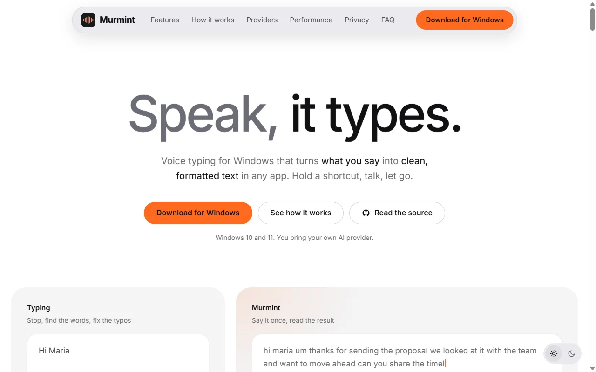
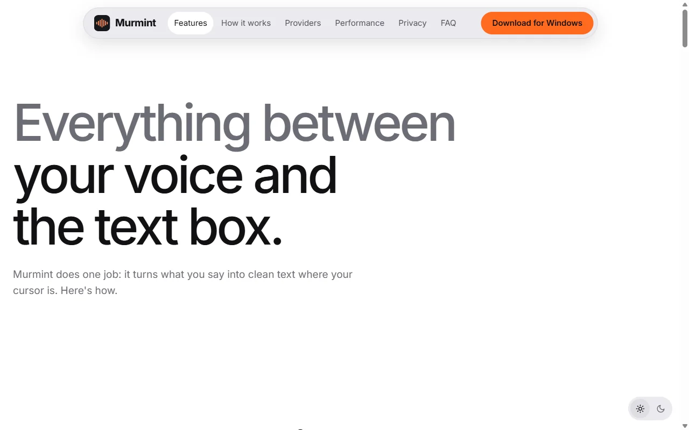
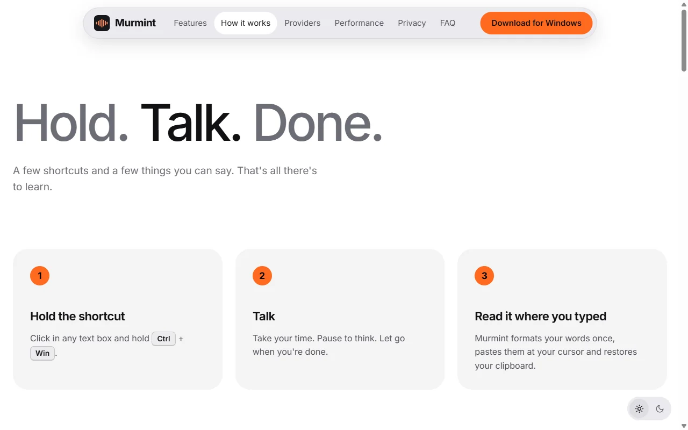
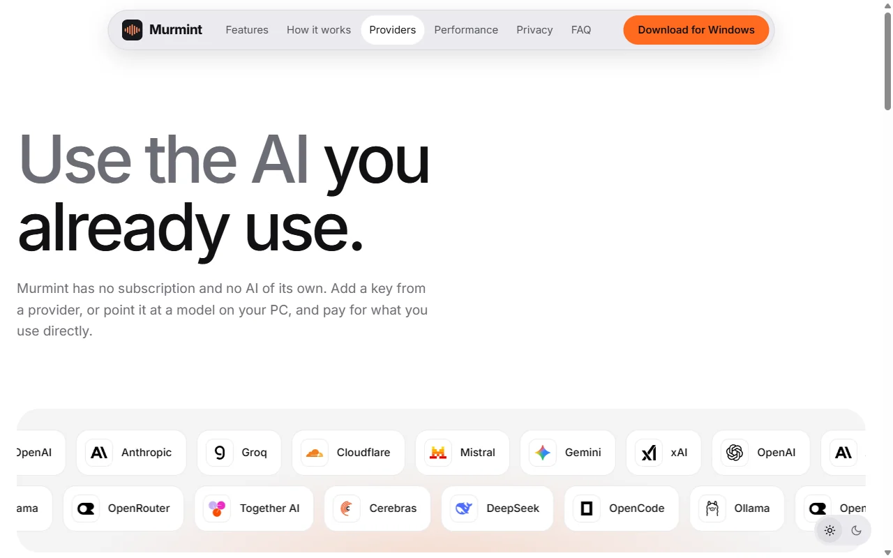

# Murmint website

The website for [Murmint](https://murmint.app), the voice-typing app for Windows. The pages are plain HTML, built and served by a small Rust server that also runs the optional Discord sign-in for the app.

<table>
<tr><td width="50%"></td><td width="50%"></td></tr>
<tr><td></td><td></td></tr>
</table>

The app itself lives at [proimpacts/murmint](https://github.com/proimpacts/murmint).

| Folder | What's in it |
|---|---|
| `website/src/*.body.html` | the page contents |
| `website/style.css`, `website/script.js`, `website/assets/` | the look, the little script, logos and images |
| `site/` | the Rust server: builds the pages, serves them with clean URLs, Discord sign-in |

## Run it on your own PC

You need a Rust toolchain.

```bash
cargo run --release --manifest-path site/Cargo.toml -- build website
cargo run --release --manifest-path site/Cargo.toml -- serve website 8080
```

Then open http://localhost:8080. The pages work without any settings.

Discord sign-in needs a Discord application. Put these in `site/discord.env` (it's git-ignored), or in your host's environment variables:

```
DISCORD_CLIENT_ID=
DISCORD_CLIENT_SECRET=
DISCORD_BOT_TOKEN=
DISCORD_GUILD_ID=
DISCORD_OWNER_ID=
PUBLIC_URL=http://localhost:8080
```

Add `<PUBLIC_URL>/auth/discord/callback` as a redirect in the Discord Developer Portal.

## Editing pages

Change a file in `website/src/`, then run the `build` command again. It wraps each page in the shared header and footer and writes `website/<page>.html`.
